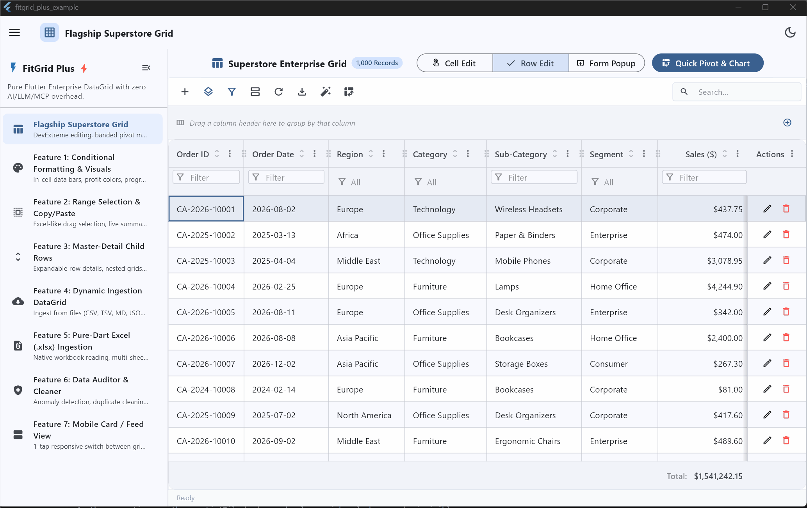

# FitGrid Plus ⚡

A high-performance, enterprise-grade virtualized canvas **DataGrid** for Flutter with **zero AI/LLM/MCP overhead**.

<p align="center">
  
</p>

`fitgrid_plus` couples a high-speed custom canvas rendering engine (`fitgrid_table`) with a comprehensive enterprise productivity suite: DevExtreme-style editing (cell, row, modal form), dynamic Pivot Grids with banded column headers and split canvas charts, multi-level hierarchical grouping, pure Dart Excel (.xlsx) import & export, responsive mobile card feed with swipe actions, rectangular range selection with instant statistical summaries, and deterministic data quality auditing.

---

## ✨ Features

- **🚀 Ultra-Fast Canvas Virtualization**: Measures text and paints cells on canvas instead of inflating heavy widget trees. Smooth 60/120 FPS scrolling across 100,000+ rows.
- **✏️ DevExtreme-Style Multi-Mode Editing**:
  - **Inline Cell Editing**: Click/tap to edit directly inside cells with built-in or custom editors.
  - **Inline Row Editing**: Row-level draft staging with Save (`✓`) and Cancel (`✕`) action buttons.
  - **Modal Form Popup Dialog**: Auto-generated responsive form dialog with validation indicators and column-grouped layouts.
  - **Lifecycle Hooks**: Full `beforeSave`, `afterSave`, `beforeDelete`, `afterDelete` async validation pipelines.
- **📊 Dynamic Pivot Grid & Canvas Split Charts**:
  - Drag-and-drop Pivot Field Chooser (Row, Column, Filter, and Data dimensions).
  - Built-in aggregations: Sum, Average, Count, Min, Max.
  - Auto-generated banded column headers.
  - Moveable split panel canvas charts: Grouped Bar, Column, Line Trend, and Pie/Donut.
- **🗂️ Multi-Level Hierarchical Grouping**:
  - Interactive top group panel with draggable chip tags.
  - Expand/collapse all groups with subtotal record counters.
- **📑 Excel (.xlsx), CSV, TSV & JSON I/O**:
  - Pure Dart OpenXML `.xlsx` parser and builder — zero native C++ or external platform dependencies.
  - Export visible or selected rows with styling and formatting.
  - Multi-sheet workbook picker dialog.
- **📱 Responsive Mobile Card View**:
  - Seamless toggle between virtualized canvas grid and mobile card feed.
  - Swipe-to-edit and swipe-to-delete contextual card actions.
- **📐 Rectangular Range Selection & Summary Metrics**:
  - Excel-style multi-cell drag selection.
  - Instant live status bar reporting Count, Sum, Average, Min, and Max.
  - Single-click Copy Range to Clipboard as TSV.
- **🎨 Conditional Formatting**:
  - Data bars, color scale heatmaps, cell highlight badges, and row coloring rules.
- **🧹 Deterministic Data Quality Auditor & Cleaner**:
  - Detects duplicate records, trailing whitespace, invalid emails, date anomalies, and numerical inconsistencies.
  - 1-click anomaly cleaner with detailed audit reports.
- **💾 Layout & State Persistence**:
  - Automatically saves and restores column order, column widths, visibility, grouping, filters, and sort orders via `SharedPreferences`.

---

## 📦 Installation

Add `fitgrid_plus` to your `pubspec.yaml`:

```yaml
dependencies:
  flutter:
    sdk: flutter
  fitgrid_plus:
    path: path/to/fitgrid_plus # or git / pub version
  material_ui: ^1.8.0
```

---

## 🚀 Quick Start

```dart
import 'package:flutter/material.dart';
import 'package:fitgrid_plus/fitgrid_plus.dart';

void main() {
  runApp(const MyApp());
}

class MyApp extends StatelessWidget {
  const MyApp({super.key});

  @override
  Widget build(BuildContext context) {
    return const MaterialApp(
      home: MyDataGridScreen(),
    );
  }
}

class MyDataGridScreen extends StatefulWidget {
  const MyDataGridScreen({super.key});

  @override
  State<MyDataGridScreen> createState() => _MyDataGridScreenState();
}

class _MyDataGridScreenState extends State<MyDataGridScreen> {
  late final FitGridPlusController _controller;
  late final LocalFitGridPlusDataSource _dataSource;

  @override
  void initState() {
    super.initState();
    _controller = FitGridPlusController();

    _dataSource = LocalFitGridPlusDataSource(
      columns: [
        const FitGridPlusColumn(
          field: 'id',
          title: 'Order ID',
          type: FitGridPlusColumnType.number,
          width: 90,
          editable: false,
        ),
        const FitGridPlusColumn(
          field: 'customer',
          title: 'Customer Name',
          type: FitGridPlusColumnType.text,
          width: 180,
          editable: true,
          required: true,
        ),
        const FitGridPlusColumn(
          field: 'amount',
          title: 'Total Amount',
          type: FitGridPlusColumnType.currency,
          width: 130,
          editable: true,
        ),
        const FitGridPlusColumn(
          field: 'status',
          title: 'Status',
          type: FitGridPlusColumnType.select,
          selectOptions: ['Pending', 'Processing', 'Delivered', 'Cancelled'],
          width: 140,
          editable: true,
          isGroupable: true,
        ),
      ],
      initialData: [
        {'id': 1001, 'customer': 'Acme Corp', 'amount': 1250.00, 'status': 'Delivered'},
        {'id': 1002, 'customer': 'Globex Inc', 'amount': 840.50, 'status': 'Processing'},
        {'id': 1003, 'customer': 'Soylent Corp', 'amount': 2300.00, 'status': 'Pending'},
      ],
    );
  }

  @override
  void dispose() {
    _controller.dispose();
    super.dispose();
  }

  @override
  Widget build(BuildContext context) {
    return Scaffold(
      appBar: AppBar(title: const Text('FitGrid Plus')),
      body: FitGridPlus(
        controller: _controller,
        dataSource: _dataSource,
        showToolbar: true,
        cellSelection: true,
        showSelectionStatusBar: true,
        editingOptions: const FitGridPlusEditingOptions(
          enabled: true,
          mode: FitGridPlusEditMode.row,
          allowAdding: true,
          allowUpdating: true,
          allowDeleting: true,
        ),
      ),
    );
  }
}
```

---

## 🛠️ Editing Modes

Configure editing in `FitGridPlusEditingOptions`:

### 1. Inline Row Editing
```dart
FitGridPlusEditingOptions(
  enabled: true,
  mode: FitGridPlusEditMode.row,
  allowUpdating: true,
  allowDeleting: true,
  actionColumnPosition: FitGridPlusActionColumnPosition.right,
)
```

### 2. Modal Form Popup Editing
```dart
FitGridPlusEditingOptions(
  enabled: true,
  mode: FitGridPlusEditMode.form,
  allowAdding: true,
  allowUpdating: true,
  allowDeleting: true,
  formDialogTitle: 'Edit Order',
)
```

### 3. Inline Cell Editing
```dart
FitGridPlusEditingOptions(
  enabled: true,
  mode: FitGridPlusEditMode.cell,
  allowUpdating: true,
)
```

---

## 📊 Dynamic Pivot Grids

Activate the dynamic pivot grid engine programmatically or via the toolbar:

```dart
final pivotConfig = FitGridPlusPivotConfig(
  rowFields: [
    const FitGridPlusPivotField(field: 'category', caption: 'Category', area: FitGridPlusPivotArea.row),
  ],
  columnFields: [
    const FitGridPlusPivotField(field: 'region', caption: 'Region', area: FitGridPlusPivotArea.column),
  ],
  dataFields: [
    const FitGridPlusPivotField(
      field: 'revenue',
      caption: 'Total Revenue',
      area: FitGridPlusPivotArea.data,
      aggregation: FitGridPlusPivotAggregation.sum,
    ),
  ],
  showChart: true,
  chartType: FitGridPlusPivotChartType.column,
);

_controller.applyPivot(pivotConfig);
```

---

## 📥 Excel Import & Export

Export and import workbooks using pure Dart OpenXML parsers:

```dart
// Export to .xlsx with save dialog
final savedPath = await _controller.exportTableWithSaveDialog(fileName: 'orders_export');

// Import from file bytes or picker
final sheet = await _controller.importExcel(context: context);
```

---

## 📄 License

MIT License. Designed and built with ❤️ for Flutter developers needing high performance enterprise tables.

